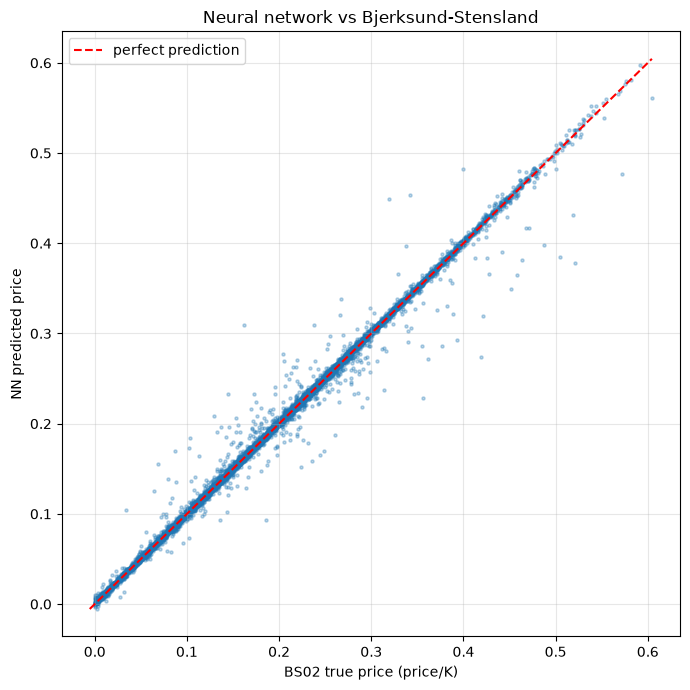

# Neural American-put surrogate

Train a feedforward network to approximate the included American-put pricing implementation over sampled option parameters.

**Saved notebook test MAE: 0.003117 in price/strike units; maximum error: 0.147484.** These measure agreement with the implemented teacher, not independently validated American-option prices.



## Quick start

From the repository root; no market data or downloads are needed after installation:

```bash
python3 -m venv .venv
.venv/bin/pip install -r requirements-dev.txt
.venv/bin/python -m pytest -q
```

`python -m src.train` generates synthetic pricing data and trains locally, writing an ignored checkpoint under `models/`. `python -m src.evaluate` evaluates that checkpoint. For a small pipeline check, use `python scripts/smoke_train.py`; it is not an accuracy benchmark.

## Method

- Sobol samples cover moneyness, maturity, rates, volatility and dividends.
- The included Bjerksund–Stensland-labelled implementation supplies approximate targets and a European fallback.
- Invalid generated prices are filtered; targets are normalized by strike.
- Standardized inputs feed a ReLU multilayer perceptron trained by squared error.
- Validation loss selects a checkpoint; separate generated samples evaluate agreement.
- A one-dimensional volatility slice checks monotonicity without enforcing it.

## Results

The [saved notebook](notebooks/01_nn_american_pricer.ipynb) records 8,192 test examples:

| Teacher-agreement measure | Price/strike units |
|---|---:|
| MAE | 0.003117 |
| RMSE | 0.008530 |
| Maximum absolute error | 0.147484 |

The original study was not retrained during cleanup. The chart is extracted directly from its saved outputs. No hardware-independent speed claim is made.

## What didn't work

The teacher emits numerical warnings and can fall back to European prices. Its accuracy against a separate American-option reference is unverified, so calling its outputs ground truth would overstate the evidence. Large worst-case surrogate errors remain. A passing monotonicity slice does not establish global no-arbitrage behavior. TODO: independently validate the teacher and boundary cases before interpreting surrogate accuracy.

## Tests, structure and licence

[](https://github.com/VChahar1/nn-american-pricer/actions/workflows/tests.yml)

Seven pricing tests pass; a tiny training/checkpoint smoke run also succeeds. `src/` contains teacher, sampling, network, training and evaluation; `tests/` checks basic pricing properties; `notebooks/` retains the study. Code: [MIT](LICENSE).
